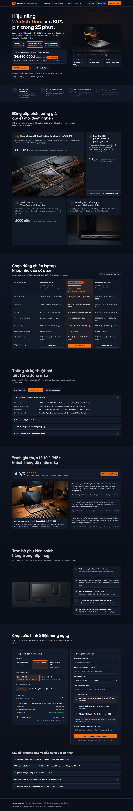
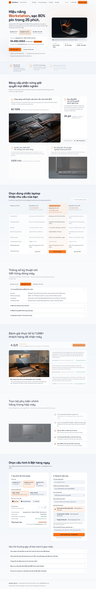

# ApexStore — Laptop Sales Landing Page (CRO & High-Contrast UI)

Landing page bán laptop hiệu năng cao (**ApexBook Air 14**, **ApexBook Pro 16**, **ApexBook Ultra X16**) xây dựng bằng **HTML/CSS/JS thuần** kết hợp **GSAP 3 + ScrollTrigger + ScrollToPlugin**, hỗ trợ chuyển đổi **Theme Tối (`#0B0F19`) / Theme Sáng (`#F8FAFC`)** và tối ưu chuyển đổi trực tiếp (Direct Checkout).

## Tính năng chính

- **Hero & Bộ chọn nhanh 3 dòng máy:** Đồng bộ 2 chiều theo thời gian thực giữa Hero, Bảng so sánh, Tab thông số kỹ thuật và Khu vực đặt hàng.
- **2 Giao diện Sáng / Tối:** Nút chuyển đổi ngay trên Header (lưu `localStorage`, không nháy màn hình khi tải lại), hỗ trợ tham số URL `?theme=light` / `?theme=dark`.
- **8 Section chuẩn CRO:** Hero → Trust Bar → Bento Grid tính năng → Bảng so sánh (có nút *Chỉ hiển thị điểm khác biệt*) → Thông số kỹ thuật Accordion → Social Proof (`4.9/5` sao) → Trọn bộ phụ kiện Flat-lay → Đặt hàng trực tiếp + FAQ.
- **Direct Checkout thông minh:** Chọn dòng máy, RAM/SSD, màu vỏ nhôm CNC, số lượng, khu vực giao nhận (hỏa tốc 2h / 24–48h), tự động tính tổng tiền, giảm `300.000đ` khi chọn VietQR, tính trả góp `0%`/tháng, lưu nháp `localStorage`, cho phép **Sửa lại thông tin** sau khi đặt, và tự ẩn Sticky Bar trên mobile khi cuộn vào form.
- **Chuyển động GSAP nhẹ nhàng:** Hero entrance timeline, `ScrollTrigger` reveals, thanh tiến trình đọc 2px, cuộn mượt `ScrollToPlugin`, tôn trọng `prefers-reduced-motion: reduce`.
- **Tối ưu tốc độ & SEO:** Toàn bộ ảnh sản phẩm định dạng `.webp` dung lượng nhẹ + `loading="lazy"` cho ảnh dưới Hero.

## Cấu trúc thư mục

```text
laptop_page/
├── index.html
├── styles.css
├── script.js
├── README.md
├── .gitignore
├── 1440x900-full.png
├── 1440x900-light-full.png
└── assets/
    ├── hero-laptop.webp
    ├── feature-chip-cooling.webp
    ├── feature-oled-ports.webp
    ├── unboxing-desk-setup.webp
    └── whats-in-box-flatlay.webp
```

## Xem trước giao diện

| Giao diện Tối (`#0B0F19`) | Giao diện Sáng (`#F8FAFC`) |
| :---: | :---: |
|  |  |

## Chạy cục bộ & Triển khai

1. **Mở trực tiếp:** Mở tệp `index.html` bằng trình duyệt hoặc chạy server tĩnh:
   ```bash
   python -m http.server 8000
   ```
   Truy cập `http://localhost:8000` (hoặc `http://localhost:8000/?theme=light`).
2. **GitHub Pages:** Đẩy thư mục lên repository GitHub, vào **Settings → Pages → Deploy from a branch (`main` / `/root`)**.
