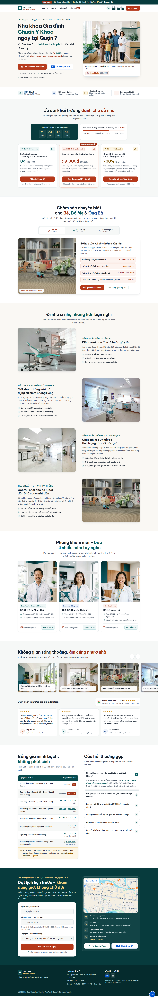

# Nha khoa Gia đình An Tâm — Landing Page Khai Trương (Quận 7, TP.HCM)

Landing page chuyển đổi (Lead Generation) viết hoàn toàn bằng **HTML5 / CSS3 / Vanilla JavaScript** kèm chuyển động **GSAP 3** (`ScrollTrigger` + `ScrollToPlugin`), thiết kế theo định hướng **Editorial Clinical Warmth** dành cho gia đình 3 thế hệ (Bé · Bố Mẹ · Ông Bà).

## Điểm nổi bật

- **Không cần build step**: Mở trực tiếp hoặc deploy tĩnh lên GitHub Pages / Netlify / Vercel / Cloudflare Pages.
- **Đầy đủ 10 section chuyển đổi**: Announcement Bar, Sticky Header, Hero, Trust Bar, Ưu đãi khai trương (đếm ngược + tiến độ suất), Dịch vụ 3 thế hệ (ARIA Tabs), 4 Cam kết vận hành, Đội ngũ bác sĩ (Popup hồ sơ `<dialog>`), Thư viện không gian & Đánh giá, Bảng giá minh bạch & FAQ, Form đặt lịch 3 trường + Bản đồ Quận 7 + Mobile Sticky Bar.
- **Tối ưu Mobile-First & Accessibility**: Cỡ chữ `16px`, tương phản đạt chuẩn WCAG AA ($\ge 4.5:1$), điều hướng bàn phím đầy đủ, tôn trọng `prefers-reduced-motion`.
- **Tối ưu tốc độ**: Toàn bộ ảnh định dạng `.webp`, lazy-load ảnh dưới màn hình đầu.
- **Sẵn sàng đo lường & đổ Lead**: Kèm sẵn cấu trúc tracking **GA4 / Meta Pixel**, trang cảm ơn (`thank-you.html`) sinh mã ưu đãi `ANTAM-XXXXX`, và file `apps-script/Code.gs` kết nối Google Sheets + thông báo Telegram.

## Cấu trúc thư mục

```text
nha-khoa-an-tam/
├── index.html              # Trang landing chính (10 section + Schema LocalBusiness)
├── thank-you.html          # Trang cảm ơn hiển thị mã ưu đãi & chỉ đường
├── 404.html                # Trang báo lỗi 404 cho GitHub Pages
├── .nojekyll               # Tắt xử lý Jekyll khi deploy GitHub Pages
├── .gitignore
├── css/
│   └── styles.css          # Design tokens, responsive layout & Editorial Clinical Warmth
├── js/
│   ├── main.js             # Cấu hình tracking, form validation, tabs, modal, carousel
│   └── motion.js           # GSAP 3 scroll reveal & smooth scrolling
├── assets/
│   └── img/                # 10 ảnh .webp đã nén tối ưu
├── apps-script/
│   └── Code.gs             # Google Apps Script nhận form -> Google Sheets + Telegram
└── design-system/          # Tài liệu Design System
```

## Xem thử trên máy (Local)

Chạy bằng bất kỳ static server nào (ví dụ Python):

```bash
python -m http.server 8080
```

Sau đó mở `http://localhost:8080`.

## Cấu hình khi triển khai thật

1. **Kết nối Google Sheets & Telegram**:
   - Mở Google Sheet mới → **Tiện ích mở rộng > Apps Script** → dán nội dung file `apps-script/Code.gs`.
   - Điền `TELEGRAM_BOT_TOKEN` và `TELEGRAM_CHAT_ID`, sau đó **Triển khai > Ứng dụng web** (quyền truy cập: *Bất kỳ ai*) để lấy URL endpoint.
2. **Cập nhật thông số trong `js/main.js` (`CONFIG`)**:
   - `formEndpoint`: Dán URL Apps Script vừa tạo.
   - `offerDeadline`: Ngày kết thúc chiến dịch khai trương.
   - `ga4Id` & `metaPixelId`: Điền mã Google Analytics 4 và Meta Pixel (nếu chạy quảng cáo).
3. **Thay thông tin phòng khám**: Cập nhật địa chỉ, số Hotline (`0909 123 456`), link Zalo OA, số giấy phép Sở Y tế và hình ảnh thực tế tại `assets/img/`.

## Đẩy lên GitHub & bật GitHub Pages

```bash
git remote add origin https://github.com/<username>/<ten-repo>.git
git push -u origin main
```

Sau đó vào **Settings > Pages** trên GitHub, chọn **Branch: `main`** / folder **`/(root)`** → **Save** để lấy link xem trực tuyến.

## Xem trước tổng thể


